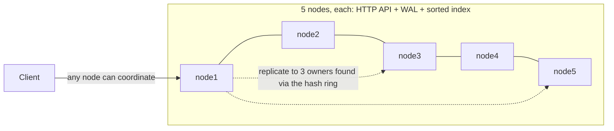

# distkv — a small distributed key-value store

A Dynamo-style, leaderless key-value store written in Python (FastAPI). Data is partitioned with **consistent hashing**, replicated to **3 of 5 nodes**, and served through **quorum reads and writes** (N=3, W=2, R=2). It keeps working when a node dies, recovers a restarted node from its **write-ahead log**, repairs stale replicas with **read repair**, and supports a sorted **prefix-scan index**.

Built to demonstrate distributed-systems fundamentals: partitioning, replication, quorum consistency, failure detection, durability and recovery.


## Architecture



**Write path:** the coordinator hashes the key, finds the 3 owner nodes on the ring, sends the write to all 3 in parallel and returns success after **W=2** acknowledgements. Each replica appends to its WAL (fsync) before acknowledging.

**Read path:** the coordinator asks the 3 owners, returns after **R=2** replies, picks the newest version, and repairs any stale replica in the background (**read repair**).

Because **R + W > N**, every read quorum overlaps every write quorum, so a read always sees the latest acknowledged write. Any single node can fail with no loss of availability for any key.

## Quick start

### Option A: Docker Compose (recommended)
```bash
docker compose up -d --build      # 5 nodes on localhost:8001..8005
./scripts/demo.sh                 # guided demo: replicate, kill a node, recover
docker compose down -v            # clean up
```

### Option B: no Docker
```bash
python -m venv .venv && source .venv/bin/activate
pip install -r requirements.txt
./scripts/run_local.sh            # 5 nodes on localhost:8001..8005
curl -X PUT localhost:8001/kv/hello -H 'content-type: application/json' -d '{"value":"world"}'
curl localhost:8004/kv/hello      # read through a different node
./scripts/stop_local.sh
```

### Try it by hand
```bash
curl localhost:8001/cluster/locate/user:42             # which 3 nodes own this key
curl -X PUT localhost:8001/kv/user:42 -H 'content-type: application/json' -d '{"value":"alice"}'
docker compose stop node3                               # kill a node
curl localhost:8002/kv/user:42                          # still served
curl "localhost:8002/scan?prefix=user:&limit=10"        # prefix query, node down
docker compose start node3                              # restarts, recovers from its WAL
curl localhost:8001/cluster/status                      # heartbeat view of the cluster
```

## API

| Method | Path | Description |
|---|---|---|
| `PUT` | `/kv/{key}` body `{"value": "..."}` | Quorum write. `503` if fewer than W replicas respond |
| `GET` | `/kv/{key}` | Quorum read, `404` if absent or deleted, `503` if fewer than R respond |
| `DELETE` | `/kv/{key}` | Quorum delete (tombstone) |
| `GET` | `/scan?prefix=&limit=` | Sorted prefix query across the cluster |
| `GET` | `/cluster/status` | Config, key count, peer liveness (heartbeats) |
| `GET` | `/cluster/locate/{key}` | Replica set for a key |
| `GET` | `/health` | Liveness probe |

## Tests
```bash
pip install -r requirements.txt
pytest -m "not e2e"    # unit tests: ring distribution/stability, WAL recovery, LWW, tombstones
pytest -m e2e          # boots 5 real node processes and kills them mid-test
```
The end-to-end tests check: any node can coordinate; a replica can die and writes/reads still succeed; a restarted replica recovers from its WAL and is **read-repaired**; losing 2 of 3 replicas returns `503` instead of stale data; prefix scans stay complete with a node down. CI runs both suites on every push.

## Load test
```bash
python loadtest/loadtest.py --nodes http://localhost:8001,http://localhost:8002,http://localhost:8003 \
    --duration 15 --concurrency 32 --write-ratio 0.3
```
Run it once with all nodes up, then stop a node and re-run against the remaining ones. Record your own numbers (they depend heavily on hardware; running 5 nodes and the load generator on one laptop is CPU-bound):

| Scenario | Throughput (ops/s) | p50 (ms) | p95 (ms) | Errors |
|---|---|---|---|---|
| 5 nodes up | _fill in_ | _fill in_ | _fill in_ | _fill in_ |
| 1 node down | _fill in_ | _fill in_ | _fill in_ | _fill in_ |

## Design decisions and trade-offs

| Decision | Why | Trade-off |
|---|---|---|
| Consistent hashing, 128 virtual nodes/node | Even spread; adding/removing a node moves only ~1/N of keys (tested) | Membership is static (set via `PEERS`), no dynamic rebalancing |
| N=3, W=2, R=2 | R+W>N gives read-your-latest-write; tolerates 1 failed replica per key | A write needs 2 live replicas, and with 2 down it returns 503 (consistency over availability, a CP-leaning choice) |
| 5 nodes, 3 replicas per key | The ring does real partitioning; with only 3 nodes every node would hold every key | More containers to run |
| Leaderless, any node coordinates | No single point of failure, no election | Concurrent writes need a conflict rule |
| Last-write-wins on (timestamp, origin id) | Simple, deterministic, convergent | Relies on roughly synced clocks; concurrent writes to one key can lose one. Vector clocks would fix it |
| Tombstones for deletes | A stale replica can't resurrect deleted data | Tombstones are never garbage-collected |
| WAL + fsync + compaction on startup | Durable acks; recovery by replay; torn tail write tolerated | One fsync per write; `FSYNC=0` trades durability for speed |
| Sorted key index + scatter-gather scan | O(log n + k) per node; complete with < N nodes down | A scan contacts every node; tombstones can shrink a page |
| Read repair, no hinted handoff or Merkle trees | Heals keys that get read, with simple code | Keys never read stay stale until touched (no background anti-entropy) |

## Known limitations (and what I would build next)
- Static membership: no node join/leave or data streaming. Next: gossip membership and rebalancing.
- No anti-entropy: add Merkle-tree sync to heal keys that are never read.
- Partial writes are not rolled back: a write that fails quorum may still exist on one replica and can surface later (the usual Dynamo behaviour).
- LWW uses wall clocks. Next: vector clocks or hybrid logical clocks.
- No auth or TLS between nodes.

## Project layout
```
kvnode/ring.py       consistent-hash ring with virtual nodes
kvnode/storage.py    WAL, recovery, compaction, sorted index
kvnode/main.py       coordinator logic: quorum, read repair, heartbeats, API
tests/               unit + end-to-end (real processes, real kills)
loadtest/            async load generator (ops/s, p50/p95/p99)
scripts/             run_local.sh, stop_local.sh, demo.sh
docker-compose.yml   5-node cluster
```

## Config (environment variables)
`NODE_ID`, `PEERS` (`id=url,...`), `N` (3), `W` (2), `R` (2), `DATA_DIR`, `FSYNC` (1), `RPC_TIMEOUT` (0.8s), `HEARTBEAT_INTERVAL` (2s).
