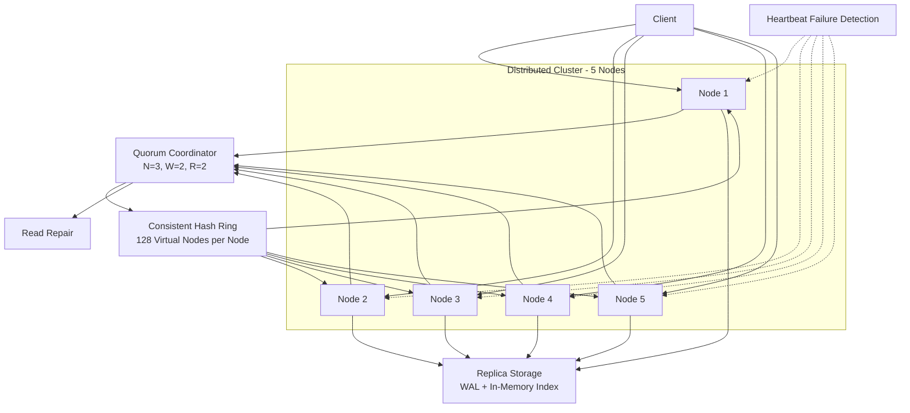
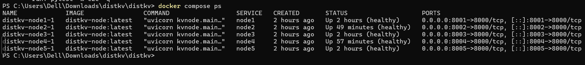
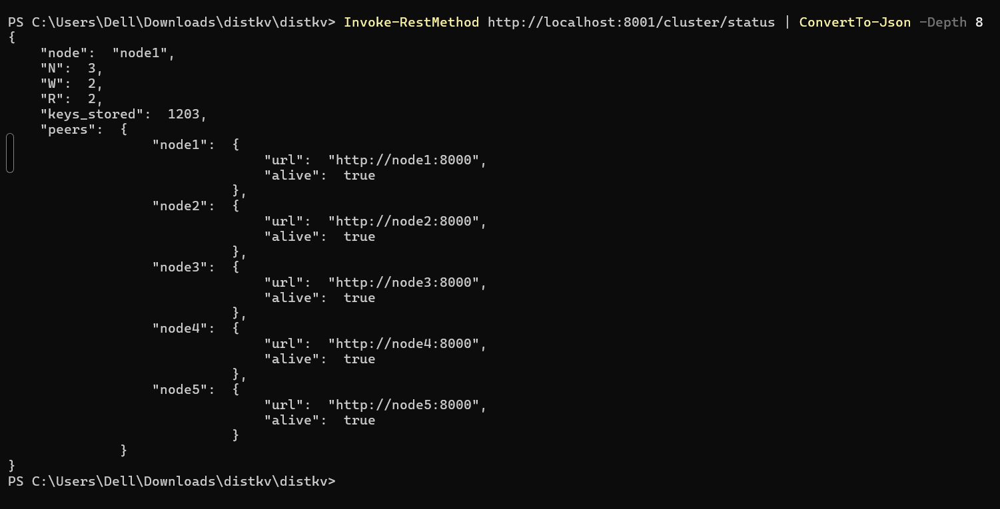
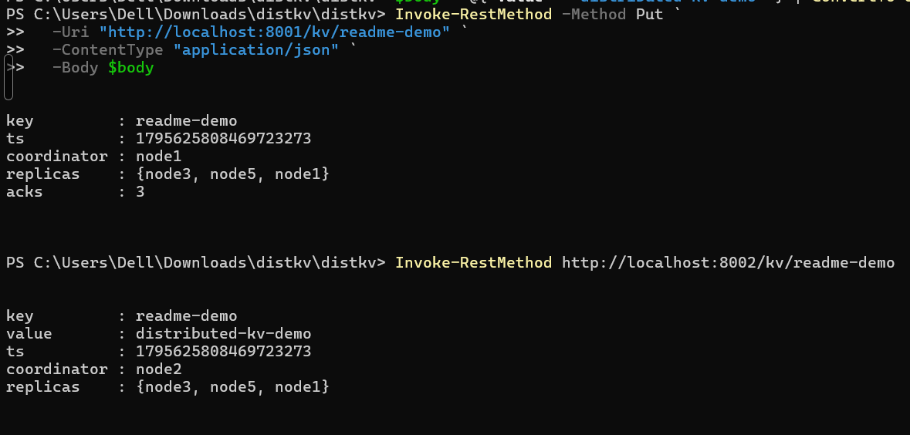
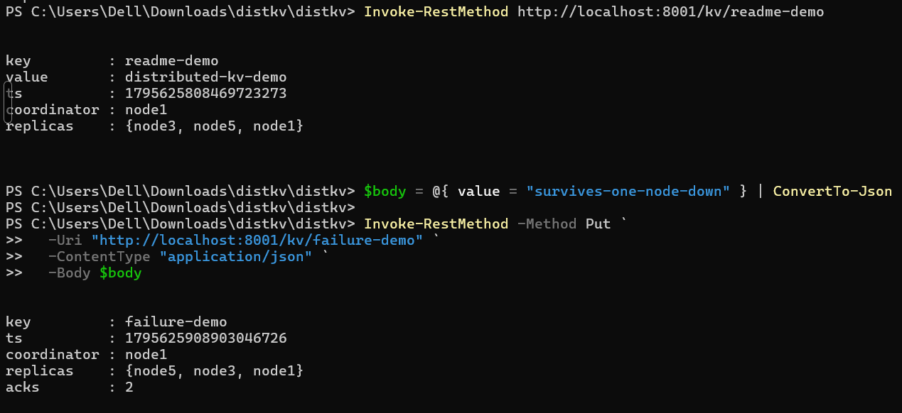
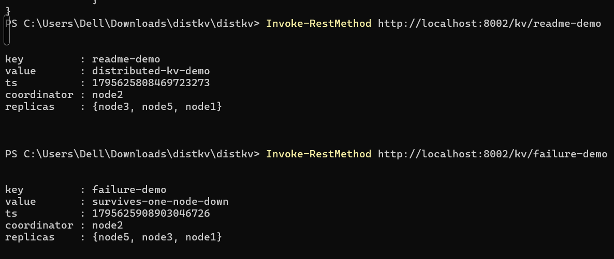

# Distributed KV Store

A fault-tolerant, leaderless distributed key-value store built with **Python and FastAPI**, demonstrating core distributed-systems concepts including consistent hashing, quorum replication, failure detection, durable storage, and replica recovery.

The system runs across **5 independent nodes**, partitions data using consistent hashing, and maintains **3 replicas per key** with quorum-based reads and writes (**N=3, W=2, R=2**).

It supports node failures, WAL-based recovery, read repair, and distributed prefix scans.

**Built to demonstrate backend engineering, distributed systems, fault tolerance, and storage fundamentals.**

[](https://github.com/shreyacode11/distributed-kv-store/actions/workflows/ci.yml)

**Repository:** [github.com/shreyacode11/distributed-kv-store](https://github.com/shreyacode11/distributed-kv-store)

---

## System Architecture



### Write Path

1. A client sends a PUT request to any available node.
2. The receiving node acts as the coordinator.
3. Consistent hashing identifies the three replica owners.
4. The coordinator sends writes to the replicas in parallel.
5. Each replica appends the operation to its write-ahead log and flushes it before acknowledging.
6. The coordinator returns success after receiving at least **W=2 acknowledgements**.

### Read Path

1. A client sends a GET request to any available node.
2. The coordinator identifies the three replica owners.
3. It requests values from the replicas.
4. After receiving **R=2 responses**, it selects the newest available version using the last-write-wins conflict rule.
5. Stale replicas are repaired through read repair.

With **R + W > N**, read and write quorums intersect. The practical consistency guarantee also depends on the last-write-wins timestamp and conflict-resolution assumptions.

---

## Key Features

- **Distributed Architecture:** Five independent nodes with HTTP-based communication.
- **Consistent Hashing:** 128 virtual nodes per physical node for key distribution.
- **Quorum Replication:** Three replicas per key using N=3, W=2, R=2.
- **Fault Tolerance:** Continues serving operations when one replica is unavailable.
- **Quorum Enforcement:** Returns HTTP 503 when the required quorum cannot be reached.
- **Failure Detection:** Heartbeat-based node health monitoring.
- **Read Repair:** Repairs stale replica data during read operations.
- **Persistent Storage:** Write-ahead logging with fsync and recovery.
- **WAL Compaction:** Startup and runtime log compaction.
- **Sorted Prefix Scanning:** Efficient prefix queries using a sorted key index.
- **Tombstones:** Preserves deletion information to prevent stale replicas from resurrecting deleted keys.
- **Containerized Deployment:** Five-node Docker Compose environment.
- **Automated Testing:** Unit and end-to-end tests covering storage, replication, and failure scenarios.
- **Async Load Testing:** Measures throughput, latency percentiles, and request errors.

---

## Technology Stack

| Category | Technologies |
|---|---|
| Programming Language | Python |
| Backend Framework | FastAPI |
| API Communication | REST, HTTPX |
| Async Processing | Asyncio |
| Storage | In-memory dictionary, sorted key index |
| Persistence | Write-Ahead Log, fsync |
| Distributed Systems | Consistent Hashing, Quorum Replication |
| Fault Tolerance | Heartbeats, Read Repair |
| Containerization | Docker, Docker Compose |
| Testing | Pytest |
| Load Testing | HTTPX, Asyncio |
| CI/CD | GitHub Actions |

---

## Quick Start

### Prerequisites

- Python 3.11 or later
- Docker Desktop
- Docker Compose

### Option 1: Docker Compose (Recommended)

Clone the repository:

```bash
git clone https://github.com/shreyacode11/distributed-kv-store.git
cd distributed-kv-store
```

Build and start the five-node cluster:

```bash
docker compose up -d --build
```

The nodes are available at:

| Node | Endpoint |
|---|---|
| Node 1 | http://localhost:8001 |
| Node 2 | http://localhost:8002 |
| Node 3 | http://localhost:8003 |
| Node 4 | http://localhost:8004 |
| Node 5 | http://localhost:8005 |

Check cluster status:

```bash
curl http://localhost:8001/cluster/status
```

Run the guided demonstration:

```bash
./scripts/demo.sh
```

Stop the cluster:

```bash
docker compose down
```

To remove persistent Docker volumes as well:

```bash
docker compose down -v
```

### Option 2: Run Without Docker

Create a virtual environment:

```bash
python -m venv .venv
```

Activate it on Windows:

```powershell
.venv\Scripts\Activate.ps1
```

Install dependencies:

```bash
pip install -r requirements.txt
```

Start the local cluster:

```bash
bash scripts/run_local.sh
```

Stop the processes:

```bash
bash scripts/stop_local.sh
```

---

## API Reference

| Method | Endpoint | Description |
|---|---|---|
| PUT | `/kv/{key}` | Write a key-value pair using quorum replication |
| GET | `/kv/{key}` | Read a value using quorum reads |
| DELETE | `/kv/{key}` | Delete a key using a tombstone |
| GET | `/scan?prefix=&limit=` | Sorted distributed prefix scan |
| GET | `/cluster/status` | Cluster configuration and peer health |
| GET | `/cluster/locate/{key}` | Identify the replica owners for a key |
| GET | `/health` | Node health check |

### Example: Write a Key

```bash
curl -X PUT http://localhost:8001/kv/user:42 \
  -H "Content-Type: application/json" \
  -d '{"value":"alice"}'
```

### Example: Read Through Another Node

```bash
curl http://localhost:8004/kv/user:42
```

### Example: Locate Replicas

```bash
curl http://localhost:8001/cluster/locate/user:42
```

### Example: Prefix Scan

```bash
curl "http://localhost:8001/scan?prefix=user:&limit=10"
```

### Example: Delete a Key

```bash
curl -X DELETE http://localhost:8001/kv/user:42
```

---

## Fault Tolerance and Recovery

The cluster was tested using Docker Compose by deliberately stopping and restarting replica nodes.

| Scenario | Observed Result |
|---|---|
| All five nodes operational | Reads and writes successful |
| One replica stopped | Read quorum maintained |
| Write with one replica stopped | Successful with two acknowledgements |
| Stopped replica restarted | Node recovered and became healthy |
| Data accessed after recovery | Previously written values remained readable |
| Two of three replicas stopped | HTTP 503 returned when read quorum was unavailable |
| All nodes restored | All five peers reported alive |

These tests demonstrate quorum enforcement, continued operation during a single replica failure, and node recovery.

---

## Project Screenshots

### Five-node Docker cluster



### Cluster health



### Write and read replication



### Fault tolerance



### Node recovery



---

## Automated Testing

Run the complete test suite:

```bash
python -m pytest -q
```

**Latest verified result: 21 tests passed.**

The tests cover storage operations, WAL recovery, compaction, replication, and end-to-end cluster behavior.

---

## Performance Benchmarks

Benchmarks were executed locally using Docker Compose. Results depend on hardware, Docker overhead, and system load.

### Comparable Benchmark: 5 Nodes vs. 4 Nodes

Both runs used:

- 8 concurrent workers
- 100-key keyspace
- 30% write ratio
- 15-second target duration

| Metric | 5 Nodes | 4 Nodes (1 Down) |
|---|---:|---:|
| Requests | 504 | 451 |
| Successful | 504 | 450 |
| Errors | 0 | 1 |
| Throughput | 33 ops/s | 30 ops/s |
| p50 latency | 206.9 ms | 201.6 ms |
| p95 latency | 469.7 ms | 679.7 ms |
| p99 latency | 665.6 ms | 1021.2 ms |
| Success rate | 100% | 99.78% |

### Higher-Concurrency Baseline

An additional five-node run used 32 concurrent workers and a 2,000-key keyspace.

| Metric | Result |
|---|---:|
| Requests | 512 |
| Successful | 512 |
| Errors | 0 |
| Throughput | 31 ops/s |
| p50 latency | 769.8 ms |
| p95 latency | 2286.7 ms |
| p99 latency | 3080.7 ms |

These are individual local runs, not averaged benchmark results. The configurations differ, so the higher-concurrency run should not be directly compared with the 8-worker measurements.

### Run Your Own Benchmark

```bash
python loadtest/loadtest.py \
  --nodes http://localhost:8001,http://localhost:8002,http://localhost:8003,http://localhost:8004,http://localhost:8005 \
  --duration 15 \
  --concurrency 32 \
  --write-ratio 0.3
```

---

## Design Decisions and Trade-offs

| Decision | Benefit | Trade-off |
|---|---|---|
| Consistent hashing with 128 virtual nodes | Distributes keys across nodes | Static membership; no dynamic rebalancing |
| N=3, W=2, R=2 | Quorum intersection and tolerance of one unavailable replica | Operations fail when quorum is unavailable |
| Five physical nodes | Demonstrates real partitioning and replication | More resources required |
| Leaderless coordination | Any node can coordinate a request | Requires deterministic conflict resolution |
| Last-write-wins | Simple and deterministic conflict handling | Depends on timestamps and can lose concurrent updates |
| Tombstones | Prevents deleted data from being resurrected | Tombstones are not garbage-collected |
| WAL with fsync | Durable acknowledgements and recovery | Additional write latency |
| Sorted key index | Efficient prefix scans | Distributed scans contact multiple nodes |
| Read repair | Repairs stale replicas during reads | Does not repair keys that are never read |

---

## Known Limitations and Future Improvements

- **Dynamic Membership:** Add node discovery, membership changes, and data rebalancing.
- **Anti-Entropy:** Introduce Merkle-tree synchronization for background replica reconciliation.
- **Hinted Handoff:** Queue writes for temporarily unavailable replicas.
- **Conflict Resolution:** Evaluate vector clocks or hybrid logical clocks instead of wall-clock-based LWW.
- **Tombstone Garbage Collection:** Add safe tombstone cleanup after replica synchronization.
- **Security:** Introduce authentication and TLS for external and internal communication.
- **Observability:** Add structured logging, metrics, and distributed tracing.
- **Performance:** Profile network overhead, disk I/O, and concurrent request handling.

---

## Project Structure

```text
distributed-kv-store/
|
|-- .github/
|   |-- workflows/          GitHub Actions CI
|
|-- kvnode/
|   |-- ring.py             Consistent hashing and virtual nodes
|   |-- storage.py          WAL, recovery, compaction, sorted index
|   |-- main.py             FastAPI, quorum coordination, read repair
|
|-- tests/                  Unit and end-to-end tests
|-- loadtest/               Async throughput and latency benchmark
|-- scripts/                Local cluster and demo scripts
|-- screenshots/            Cluster and fault-tolerance screenshots
|
|-- Dockerfile
|-- docker-compose.yml
|-- requirements.txt
|-- pytest.ini
|-- Makefile
|-- README.md
```

---

## Configuration

The cluster uses environment variables for node configuration:

| Variable | Description |
|---|---|
| `NODE_ID` | Current node identifier |
| `PEERS` | Node IDs and their URLs |
| `N` | Replica count |
| `W` | Write quorum |
| `R` | Read quorum |
| `DATA_DIR` | Persistent storage directory |
| `FSYNC` | Enable or disable WAL fsync |
| `RPC_TIMEOUT` | Internal request timeout |
| `HEARTBEAT_INTERVAL` | Peer health-check interval |

---

## Author

**Shreya B. Saboji**

Software Engineering | Backend Development | Distributed Systems

[GitHub](https://github.com/shreyacode11)

---

*An engineering project exploring distributed storage, replication, consistency, fault tolerance, and recovery.*